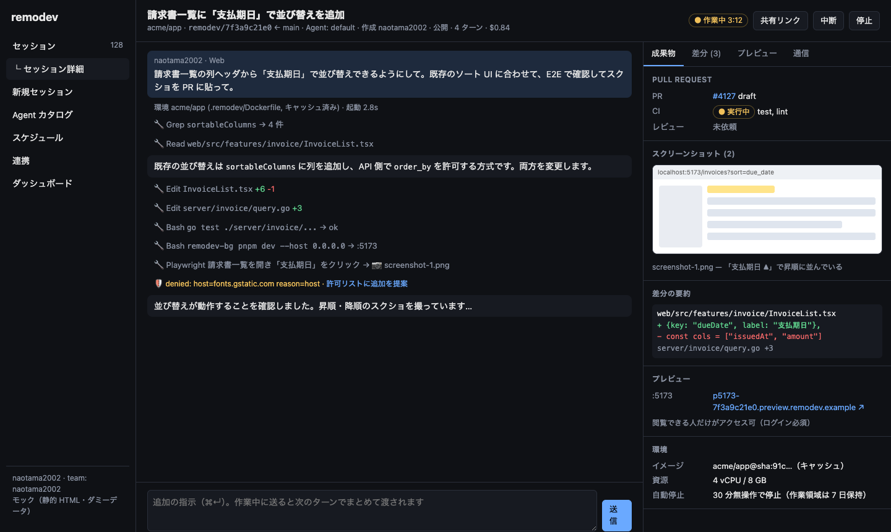

# remodev ビジョン

remodev は、チームのプロダクト開発を支えるセルフホスト型の Background Coding Agent 基盤です。
LayerX「haro」を主な目標像とし、Ubie「Remoco / unaba」、GMO Flatt Security「Sunaba」の考え方を取り入れます。

画面のモック: [docs/mocks/index.html](mocks/index.html)（静的 HTML。ブラウザで開くと全画面を切り替えて見られる）



## 1. 目指す姿

> 「コードを読み書きでき、動作確認もできる環境」を、誰でも・どこからでも・すぐに払い出せる。
> エージェントには確認なしで作業させ、その安全は仕組みで担保する。

- Web / Slack / 定期実行 / API から依頼すると、必要なものが揃った隔離環境で Claude Code が動き、
  実装 → 動作確認 → スクリーンショット → PR まで手放しで進む。
- セッションは原則チームに公開され、隣の人の上手な使い方を真似できる。
- 蓄積したセッションのログから、prompt や skill が自動で改善されていく（ループが閉じる）。

## 2. 設計原則

1. **サンドボックスに秘密を置かない。** 本物の認証情報は egress プロキシ（nono）だけが持ち、許可した宛先にだけ注入する。
2. **外向き通信はデフォルト拒否。** プロキシ以外に出口はない。GitHub への書き込みはセッションの対象リポジトリだけ。
3. **だから YOLO で動かせる。** 細かい承認を挟まず、寝ている間も進む。
4. **ロジックは Go、TS は表示だけ。** 依存は最小、ダウンロードするバイナリはバージョンとハッシュで固定。
5. **ランニングコストは最小。** 使っていない環境は止め、作業領域は期限で消す。ログは残す。
6. **手元でも AWS でも同じものが動く。** `docker compose up` で全機能を試せる。

## 3. 参考記事からの対応表

| 要素 | haro / Remoco / Sunaba | remodev |
|---|---|---|
| 起動経路 | Web, Slack, Scheduler, API | 同じ（Web は済） |
| 隔離 | Pod (EKS) / Kata microVM / Firecracker | Docker + internal network。オプションで gVisor / Kata |
| 認証情報 | プロキシで注入（Remoco） | nono で注入（済） |
| Agent Loop | Temporal Workflow | Go のジョブ管理 + Claude Code の `--resume` |
| 環境定義 | 社内 monorepo 向けに作り込み | `.remodev/` または devcontainer.json |
| 動作確認 | Android エミュレータ、スクショ | Playwright + 成果物保存（エミュレータは後回し） |
| 外部連携 | Slack, Notion, Linear, Datadog の MCP | MCP + 個人 OAuth を nono で注入 |
| カスタム Agent | prompt / MCP / 環境 のプリセット | 同じ |
| 公開範囲 | 原則公開、機密は制限 | 同じ。個人権限セッションは非公開 |
| 改善ループ | セッションを分析して改善 | 毎日分析して改善 PR を作る Agent |

## 4. 画面

| 画面 | 内容 |
|---|---|
| セッション一覧 | チーム全員のセッション。リポジトリ・作成者・Agent・状態で絞り込み |
| セッション詳細 | 中央にタイムライン、右に成果物パネル（スクショ・HTML・差分・プレビュー・PR/CI）、下に入力欄。URL で共有 |
| 新規セッション | リポジトリ・Agent・ベースブランチを選び指示を書く |
| Agent カタログ | カスタム Agent の一覧・作成・編集（公開） |
| スケジュール | cron で Agent を起動、結果を Slack に投稿 |
| 連携 | 個人ごとの OAuth 接続（GitHub, Notion, Linear …） |
| ダッシュボード | remodev 経由 PR の割合、利用者数、セッション数、コスト |

## 5. アーキテクチャ（最終形）

```
 Web UI ─┐                         ┌─ store: SQLite (手元) / DynamoDB or RDS (AWS)
 Slack  ─┼─► control (Go) ─────────┼─ artifacts: volume (手元) / S3 (AWS)
 cron   ─┤    ├ session manager    └─ secrets: env (手元) / Secrets Manager (AWS)
 API    ─┘    ├ scheduler
              ├ runtime: docker (手元・EC2) | ecs (将来)
              └ policy: nono profile 生成
                     │
     ┌───────── per session, internal network ─────────┐
     │ sandbox (repo 環境 + Claude Code + Playwright)   │
     │        └─ HTTPS_PROXY ─► nono ──────────────────┼─► GitHub / Anthropic / MCP / registries
     └──────────────────────────────────────────────────┘
```

AWS（低コスト構成の案）:
- control と sandbox を **EC2 スポット 1 台**（足りなくなったら Auto Scaling で台数を増やす）で動かす。
- 入口は ALB + OIDC（GitHub / Google）、プレビューはワイルドカード DNS。
- 作業領域は EBS、成果物とログのアーカイブは S3、秘密情報は Secrets Manager。
- 夜間や休日はインスタンスを 0 台にできる構成にする。

## 6. ロードマップ

### Phase 1: 実際の開発に使える（いまここ）
- [x] 隔離 + nono による認証情報注入
- [x] Web UI、ログのリアルタイム配信、PR 作成
- [ ] 環境定義（`.remodev/Dockerfile` / devcontainer.json、イメージのキャッシュ）
- [ ] Playwright での動作確認とスクショ、成果物パネル
- [ ] 差分の表示、CI 状態の表示

### Phase 2: チームで使える
- [ ] GitHub ログイン、org / ユーザーでの制限
- [ ] セッションの公開範囲（公開 / 非公開）
- [ ] Slack（スレッドから起動、結果をスレッドに返信、追加の指示）
- [ ] AWS 構成（Terraform）
- [ ] GitHub App のトークン（リポジトリ単位、短命）

### Phase 3: haro らしさ
- [ ] Agent カタログ（UI から作成・編集）
- [ ] MCP 接続と個人 OAuth（nono で注入、個人セッションは非公開）
- [ ] スケジュール実行、HTTP API からの起動
- [ ] HTML 成果物へのコメント → AI へのフィードバック

### Phase 4: ループを閉じる
- [ ] ダッシュボード（PR 割合・利用者・セッション・コスト）
- [ ] 前日のセッションを分析し、prompt / skill の改善 PR を出す Agent
- [ ] 実行中ターンの耐久性（control 再起動をまたいで継続）

## 7. やらないこと（当面）

- 自前の microVM 基盤（Firecracker / Sunaba 相当）。必要になったら Kata / gVisor から試す。
- Temporal の導入。ジョブ表で足りなくなったら再検討する。
- Android エミュレータ（KVM が使える metal インスタンスが必要なため）。
